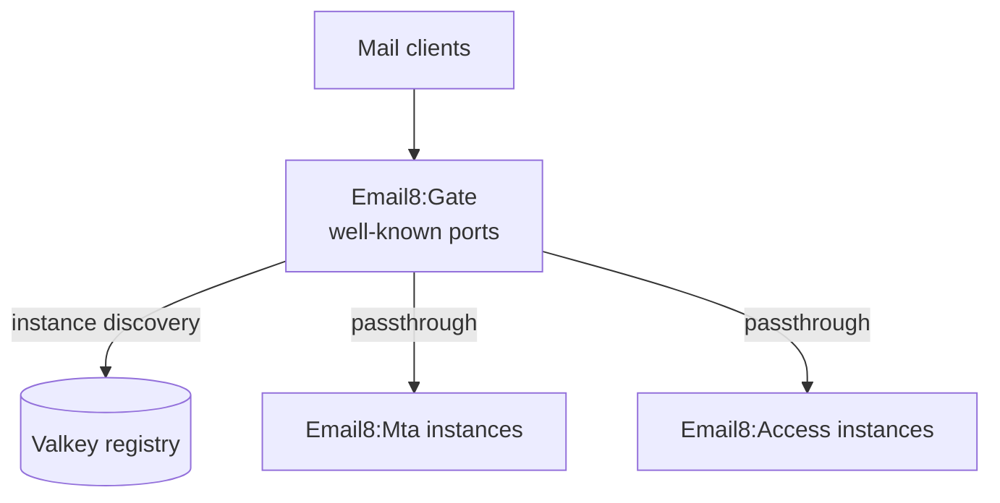

# Sentin8 Email8:Gate - Mail Port Passthrough

## 1. Summary

Email8:Gate is the raw-TCP front door for the well-known mail ports
(SMTP submission 587, SMTPS 465, IMAPS 993, …). It terminates the
TLS/TCP listener set, discovers the MTA/Access instances' actual
binds via the Valkey registry, and passthroughs protocol streams to
them - one Gate owns the well-known ports per host while each
instance binds OS-ephemeral.

## 2. Architecture

## 3. Key Traits

- Well-known port ownership: the ONLY mail listener on 25/465/587/
  993/995/143 on a fleet node.
- Instance discovery from Valkey; connections forward to live
  instance binds.
- Protocol-transparent: no mail parsing at the Gate layer.
- Audit journal (AUDJOUR-1, architecture-principles §6.8): the
  `gate.audit_journal` leaf-schema table (migration v2 - the 15-column
  `sentin8_audit::audit_journal_sql` contract, the gate leaf schema's
  first object) is drained to Sys `POST /v1/audit` by the shell's
  boot-8c pusher, presenting the `gate-audit` workload certificate
  (`sentin8:sys:audit:write`).

See the vertical group docs (`email8/README.md`) for the four-service
mail plane overview.

---

**Architecture & Design:** email8:gate and its underlying concepts were designed by [Hamid Jahanzad](https://www.linkedin.com/in/hamidjahanzad/).
